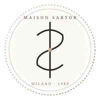
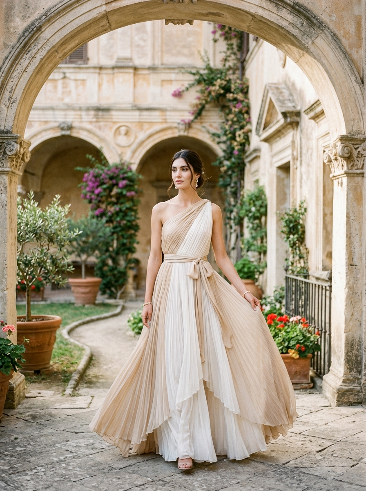
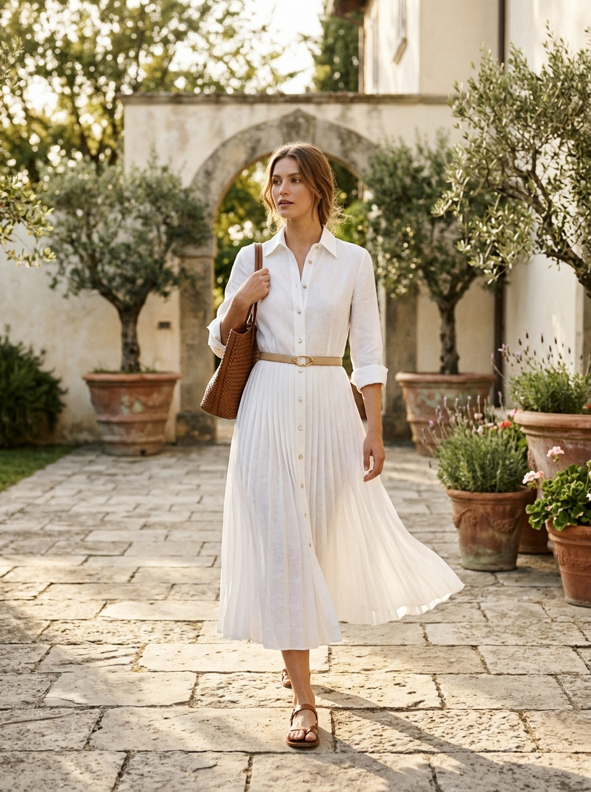
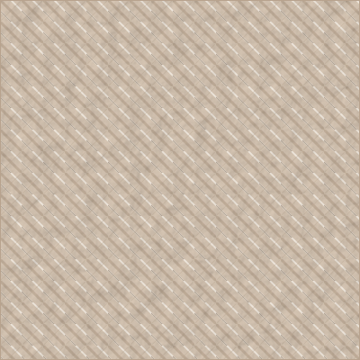

# Ex02 Commercial Website


## AIM
To create a commercial website using CSS Flexbox.

## ALGORITHM
### STEP 1
Create an HTML file (index.html)

### STEP 2
Create a CSS file (style.css)

### STEP 3
Include a navigation bar with links to different sections.

### STEP 4
Add structured sections for Homepage, Products / Services, About Us, Contact Details and User Account.

### STEP 5
Include social media links at the footer with copyright information.

### STEP 6
Define global styles for fonts, colors, and layout.

### STEP 7
Style the header, navigation bar, and sections.

### STEP 8
Use Flexbox for layout design.

### STEP 9
Add hover effects and transitions for interactivity.

### STEP 10
Add Images and Media.

### STEP 11
Use optimized images for a professional look.

### STEP 12
Open the HTML file in a browser to check layout and functionality.

### STEP 13
Fix styling issues and refine content placement.

### STEP 14
Deploy the website.

### STEP 15
Upload to GitHub Pages for free hosting.

## PROGRAM
## index.html
```
<!DOCTYPE html>
<html lang="en">
<head>
  <!-- Basic Meta Tags -->
  <meta charset="UTF-8">
  <meta name="viewport" content="width=device-width, initial-scale=1.0">
  <meta http-equiv="X-UA-Compatible" content="ie=edge">
  
  <title>MAISON SARTOR • Haute Sartorial Luxury &amp; Ready-to-Wear</title>
  <meta name="description" content="Maison Sartor is an Italian haute sartorial fashion house in classic beige and crisp white. Explore our 3-slide editorial presentation of bespoke suiting, couture dresses, and texture science.">
  <meta name="keywords" content="luxury fashion, sartorial menswear, classic beige blazer, bespoke suits, couture silk dress, white dress shirts, quiet luxury, Italian wool, cashmere overcoat, made in Italy">
  <meta name="author" content="Maison Sartor Atelier">
  <meta name="robots" content="index, follow, max-image-preview:large, max-snippet:-1, max-video-preview:-1">
  <link rel="canonical" href="https://www.maisonsartor.com/">
  <meta name="theme-color" content="#EFECE6">
  
  <!-- Open Graph / Social Tags -->
  <meta property="og:type" content="website">
  <meta property="og:url" content="https://www.maisonsartor.com/">
  <meta property="og:title" content="MAISON SARTOR • Haute Sartorial Luxury">
  <meta property="og:description" content="Classic beige and crisp white luxury fashion. Curated 3-slide editorial presentation of bespoke suiting, couture dresses, and cashmere outerwear.">
  <meta property="og:image" content="assets/images/hero-ambassador.jpg">
  <meta property="og:site_name" content="Maison Sartor">
  <meta property="og:locale" content="en_US">
  
  <meta name="twitter:card" content="summary_large_image">
  <meta name="twitter:title" content="MAISON SARTOR • Haute Sartorial Luxury">
  <meta name="twitter:description" content="Timeless luxury menswear and couture dresses in classic beige and white.">
  <meta name="twitter:image" content="assets/images/hero-ambassador.jpg">
  
  <!-- Google Fonts: Cormorant Garamond & Plus Jakarta Sans -->
  <link rel="preconnect" href="https://fonts.googleapis.com">
  <link rel="preconnect" href="https://fonts.gstatic.com" crossorigin>
  <link href="https://fonts.googleapis.com/css2?family=Cormorant+Garamond:ital,wght@0,300;0,400;0,500;0,600;0,700;1,400&family=Plus+Jakarta+Sans:wght@300;400;500;600;700&display=swap" rel="stylesheet">
  
  <!-- Main Stylesheet -->
  <link rel="stylesheet" href="css/styles.css">
  
  <!-- Brand Favicon -->
  <link rel="icon" type="image/svg+xml" href="assets/images/brand-seal.svg">

  <!-- Schema.org JSON-LD Structured Data -->
  <script type="application/ld+json">
  {
    "@context": "https://schema.org",
    "@graph": [
      {
        "@type": "Organization",
        "@id": "https://www.maisonsartor.com/#organization",
        "name": "Maison Sartor",
        "url": "https://www.maisonsartor.com/",
        "logo": "https://www.maisonsartor.com/assets/images/brand-seal.svg",
        "description": "Italian haute sartorial atelier producing bespoke suiting, couture dresses, and quiet luxury essentials in classic beige and white.",
        "foundingDate": "1988",
        "address": {
          "@type": "PostalAddress",
          "streetAddress": "Via Monte Napoleone 18",
          "addressLocality": "Milano",
          "postalCode": "20121",
          "addressCountry": "IT"
        }
      },
      {
        "@type": "ItemList",
        "name": "Maison Sartor 3-Chapter Collection",
        "numberOfItems": 3,
        "itemListElement": [
          {
            "@type": "Product",
            "position": 1,
            "name": "The Ambassador Bespoke Venetian Navy Suit",
            "image": "https://www.maisonsartor.com/assets/images/hero-ambassador.jpg",
            "offers": { "@type": "Offer", "price": "980.00", "priceCurrency": "USD" }
          },
          {
            "@type": "Product",
            "position": 2,
            "name": "The Aurelia Draped Silk Chiffon Evening Gown",
            "image": "https://www.maisonsartor.com/assets/images/dress-beige-silk.jpg",
            "offers": { "@type": "Offer", "price": "1250.00", "priceCurrency": "USD" }
          },
          {
            "@type": "Product",
            "position": 3,
            "name": "The Milanese Double-Breasted Cashmere Blazer",
            "image": "https://www.maisonsartor.com/assets/images/suit-beige.jpg",
            "offers": { "@type": "Offer", "price": "890.00", "priceCurrency": "USD" }
          }
        ]
      }
    ]
  }
  </script>
</head>
<body>
  <a href="#slide-1" class="skip-link">Skip to main content</a>

  <!-- =========================================================================
       HEADER & NAVIGATION
       ========================================================================= -->
  <header id="site-header" class="header" role="banner">
    <div class="container header-container">
      <a href="#slide-1" class="brand" aria-label="Maison Sartor Home">
        
        <div>
          <span class="brand-name">MAISON SARTOR</span>
          <span class="brand-descriptor">Milano • Est. 1988</span>
        </div>
      </a>

      <!-- 3-Slide Direct Navigation Links -->
      <nav class="nav" aria-label="Slide Navigation">
        <ul class="nav-menu">
          <li><a href="#slide-1" class="nav-link active" data-slide-target="1">01 Suiting &amp; Muse</a></li>
          <li><a href="#slide-2" class="nav-link" data-slide-target="2">02 Couture Dresses</a></li>
          <li><a href="#slide-3" class="nav-link" data-slide-target="3">03 Men's Capsule &amp; Lab</a></li>
        </ul>
      </nav>

      <!-- Actions -->
      <div class="header-actions">
        <select id="currency-select" class="currency-select" aria-label="Currency Selector">
          <option value="USD">USD ($)</option>
          <option value="EUR">EUR (€)</option>
          <option value="GBP">GBP (£)</option>
          <option value="INR">INR (₹)</option>
        </select>

        <button type="button" class="action-btn" data-action="open-cart" aria-label="Shopping Bag">
          <svg viewBox="0 0 24 24" fill="none" stroke="currentColor" stroke-width="1.8">
            <path d="M6 2L3 6v14a2 2 0 0 0 2 2h14a2 2 0 0 0 2-2V6l-3-4z"/>
            <line x1="3" y1="6" x2="21" y2="6"/>
            <path d="M16 10a4 4 0 0 1-8 0"/>
          </svg>
          <span class="badge-count cart-count-badge">1</span>
        </button>
      </div>
    </div>
  </header>

  <!-- =========================================================================
       FLOATING 3-SLIDE PAGINATION TRACKER & ARROWS
       ========================================================================= -->
  <aside class="slide-nav-tracker" aria-label="Slide Indicator Tracker">
    <button type="button" class="slide-nav-dot active" data-slide-target="1" title="Slide 01: Suiting &amp; Ambassador">
      <span class="slide-dot-num">01</span>
      <span class="slide-dot-pill"></span>
    </button>
    <button type="button" class="slide-nav-dot" data-slide-target="2" title="Slide 02: Donna Couture Dresses">
      <span class="slide-dot-num">02</span>
      <span class="slide-dot-pill"></span>
    </button>
    <button type="button" class="slide-nav-dot" data-slide-target="3" title="Slide 03: Men's Capsule &amp; 3D Lab">
      <span class="slide-dot-num">03</span>
      <span class="slide-dot-pill"></span>
    </button>
  </aside>

  <div class="slide-arrow-controls" aria-label="Slide Next/Prev Controls">
    <button type="button" class="slide-arrow-btn" id="slide-prev-btn" aria-label="Previous Slide">
      <svg width="18" height="18" viewBox="0 0 24 24" fill="none" stroke="currentColor" stroke-width="2">
        <polyline points="18 15 12 9 6 15"/>
      </svg>
    </button>
    <button type="button" class="slide-arrow-btn" id="slide-next-btn" aria-label="Next Slide">
      <svg width="18" height="18" viewBox="0 0 24 24" fill="none" stroke="currentColor" stroke-width="2">
        <polyline points="6 9 12 15 18 9"/>
      </svg>
    </button>
  </div>

  <!-- =========================================================================
       3-SLIDE VIEWPORT CONTAINER
       ========================================================================= -->
  <main class="slides-viewport" id="slides-viewport">

    <!-- -----------------------------------------------------------------------
         SLIDE 01: SARTORIAL SUITING & BRAND AMBASSADOR
         ----------------------------------------------------------------------- -->
    <section id="slide-1" class="slide-section" aria-labelledby="slide-1-title" data-slide-index="1">
      <div class="container">
        <div class="slide-hero-grid">
          <div>
            <div class="hero-pill">
              <span class="hero-pill-dot"></span>
              Slide 01 / 03 • Autumn/Winter Sartorial Odyssey
            </div>

            <h1 id="slide-1-title" class="hero-headline">
              The Art of Refined Form: <br>
              <span class="italic">Quiet Luxury, Perfected.</span>
            </h1>

            <p class="hero-description">
              Rooted in timeless Italian tailoring and minimalist elegance. Impeccably cut silhouettes executed in classic warm beige, crisp Egyptian poplin, and deep Venetian wool—designed to transcend ephemeral seasons.
            </p>

            <div class="hero-actions">
              <button type="button" class="btn btn-primary" data-action="quick-view" data-id="suit-navy">
                Acquire Ambassador Suit • $980
              </button>
              <button type="button" class="btn btn-outline" data-slide-target="2">
                Discover Couture Dresses ↓
              </button>
            </div>

            <div class="hero-stats-row">
              <div class="hero-stat-item">
                <span class="stat-number">40+</span>
                <span class="stat-label">Years of Mastery</span>
              </div>
              <div class="hero-stat-item">
                <span class="stat-number">Super 150s</span>
                <span class="stat-label">Biella Wool</span>
              </div>
              <div class="hero-stat-item">
                <span class="stat-number">5.0 ★</span>
                <span class="stat-label">Bespoke Rating</span>
              </div>
            </div>
          </div>

          <!-- 3D Ambassador Visual Presentation Card -->
          <div class="hero-image-card tilt-card" data-tilt-max="12">
            <div class="card-specular-glare"></div>

            <!-- Ambassador Visual Switcher -->
            <div class="ambassador-view-toggle" role="tablist" aria-label="Ambassador Portrait Switcher">
              <button type="button" class="view-toggle-btn active" id="view-ambassador-orig" data-view="orig" role="tab" aria-selected="true">
                <span class="toggle-indicator-dot"></span>
                <span>Original Portrait</span>
              </button>
              <button type="button" class="view-toggle-btn" id="view-ambassador-hd" data-view="hd" role="tab" aria-selected="false">
                <span class="toggle-indicator-dot"></span>
                <span>Studio HD Editorial</span>
              </button>
            </div>

            <div class="hero-image-container">
              
            </div>

            <div class="floating-badge badge-craft">
              <div class="badge-title">Ambassador Edition</div>
              <div class="badge-subtitle">Milanese Hand-Stitched Lapel</div>
            </div>

            <div class="floating-badge badge-tailoring">
              <div class="badge-title">Full Floating Canvas</div>
              <div class="badge-subtitle">Super 150s Vitale Barberis Wool</div>
            </div>
          </div>
        </div>
      </div>
    </section>

    <!-- -----------------------------------------------------------------------
         SLIDE 02: THE DONNA COUTURE DRESS CAPSULE
         ----------------------------------------------------------------------- -->
    <section id="slide-2" class="slide-section" aria-labelledby="slide-2-title" data-slide-index="2">
      <div class="container">
        <div class="text-center">
          <span class="section-tag">Slide 02 / 03 • Haute Couture Atelier</span>
          <h2 id="slide-2-title" class="section-title">The Donna Dress Capsule: Fluid Elegance</h2>
          <p class="section-subtitle">
            Sculptural evening silhouettes and tailored daylight essentials in classic champagne beige and crisp alabaster white.
          </p>
        </div>

        <div class="slide-dresses-grid">
          <!-- Dress 1: Aurelia Evening Gown -->
          <article class="dress-card-3d tilt-card" data-tilt-max="9">
            <div class="card-specular-glare"></div>
            <div class="dress-card-media">
              
              <span class="dress-badge-ribbon">Haute Couture</span>
            </div>
            <div class="dress-card-info">
              <span class="section-tag no-after" style="margin-bottom: 0;">Como Mulberry Silk</span>
              <h3 class="dress-card-title">The Aurelia Silk Chiffon Gown</h3>
              <p class="dress-card-desc">
                Hand-pleated asymmetric one-shoulder evening drape with a sculpted satin sash waist and sweeping hem in champagne beige.
              </p>
              <div class="dress-specs-mini">
                <span>✦ 100% Mulberry Silk Chiffon &amp; Habotai Lining</span>
                <span>✦ Hand-draped in Lake Como, Italy</span>
              </div>
              <div class="dress-card-price-row">
                <span class="dress-card-price">$1,250</span>
                <button type="button" class="btn btn-primary btn-sm" data-action="quick-view" data-id="dress-beige-silk">
                  Acquire Gown
                </button>
              </div>
            </div>
          </article>

          <!-- Dress 2: Seraphina Pleated Midi Dress -->
          <article class="dress-card-3d tilt-card" data-tilt-max="9">
            <div class="card-specular-glare"></div>
            <div class="dress-card-media">
              
              <span class="dress-badge-ribbon">New Release</span>
            </div>
            <div class="dress-card-info">
              <span class="section-tag no-after" style="margin-bottom: 0;">Belgian Linen &amp; Silk</span>
              <h3 class="dress-card-title">The Seraphina Pleated Midi Dress</h3>
              <p class="dress-card-desc">
                Crisp pure white tailored shirt collar, knife-pleated flowing skirt, Australian mother-of-pearl buttons, and classic beige leather belt.
              </p>
              <div class="dress-specs-mini">
                <span>✦ 55% Belgian Linen, 45% Silk</span>
                <span>✦ Tuscan Calfskin Belt Included</span>
              </div>
              <div class="dress-card-price-row">
                <span class="dress-card-price">$780</span>
                <button type="button" class="btn btn-primary btn-sm" data-action="quick-view" data-id="dress-white-minimal">
                  Acquire Dress
                </button>
              </div>
            </div>
          </article>
        </div>
      </div>
    </section>

    <!-- -----------------------------------------------------------------------
         SLIDE 03: MEN'S READY-TO-WEAR & 3D TEXTURE LAB
         ----------------------------------------------------------------------- -->
    <section id="slide-3" class="slide-section" aria-labelledby="slide-3-title" data-slide-index="3">
      <div class="container">
        <div class="text-center">
          <span class="section-tag">Slide 03 / 03 • Ready-to-Wear &amp; Texture Science</span>
          <h2 id="slide-3-title" class="section-title">Men's Capsule &amp; 3D Texture Laboratory</h2>
          <p class="section-subtitle">
            Explore our curated tailored essentials and inspect the microscopic weave architecture with the 3D optical loupe.
          </p>
        </div>

        <div class="slide-capsule-grid">
          <!-- Left: Men's Interactive Product Carousel -->
          <div class="menswear-carousel-card tilt-card" data-tilt-max="6">
            <div class="card-specular-glare"></div>
            <div class="menswear-carousel-header">
              <span class="section-tag no-after" style="margin-bottom: 0;">
                Curated Menswear Piece <span id="carousel-counter">1/7</span>
              </span>
              <div class="carousel-nav-arrows">
                <button type="button" class="carousel-arrow" id="mw-prev" aria-label="Previous item">←</button>
                <button type="button" class="carousel-arrow" id="mw-next" aria-label="Next item">→</button>
              </div>
            </div>

            <div class="menswear-item-display">
              <div class="menswear-item-media">
                
              </div>
              <div class="menswear-item-meta">
                <span class="product-category-text" id="mw-category">Suits &amp; Blazers</span>
                <h3 class="menswear-item-title" id="mw-title">The Milanese Cashmere Blazer</h3>
                <p class="menswear-item-desc" id="mw-desc">
                  Double-breasted soft cashmere blazer in classic warm beige with peak lapels, horn buttons, and full floating canvas.
                </p>
                <div style="font-size: 0.75rem; color: var(--color-charcoal-800); margin-bottom: 1.25rem;">
                  <strong>Fabric:</strong> <span id="mw-fabric">100% Super 150s Merino Wool &amp; Cashmere</span>
                </div>
                <div class="dress-card-price-row">
                  <span class="dress-card-price" id="mw-price">$890</span>
                  <button type="button" class="btn btn-primary btn-sm" id="mw-action-btn">
                    Quick View
                  </button>
                </div>
              </div>
            </div>
          </div>

          <!-- Right: 3D Optical Texture Laboratory -->
          <div class="texture-lab-panel tilt-card" data-tilt-max="6">
            <div class="card-specular-glare"></div>
            <div style="display: flex; justify-content: space-between; align-items: center; margin-bottom: 0.75rem;">
              <span class="section-tag no-after" style="margin-bottom: 0;">3D Micro-Weave Loupe</span>
              <span style="font-size: 0.7rem; color: var(--color-champagne); font-weight: 700;">400% Precision Optical Zoom</span>
            </div>

            <div class="fabric-specimen-viewport" id="fabric-viewport" aria-label="Interactive Fabric Viewport">
              
              <div class="fabric-loupe-lens" id="fabric-loupe" aria-hidden="true">
                
              </div>
            </div>

            <!-- 4 Texture Switcher Pills -->
            <div class="texture-selector-row">
              <button type="button" class="texture-btn-pill active" data-specimen="wool-twill">Wool Twill</button>
              <button type="button" class="texture-btn-pill" data-specimen="cotton-poplin">Giza Poplin</button>
              <button type="button" class="texture-btn-pill" data-specimen="cashmere">Cashmere</button>
              <button type="button" class="texture-btn-pill" data-specimen="silk-chiffon">Silk Chiffon</button>
            </div>

            <div style="margin-top: 1rem; display: flex; justify-content: space-between; font-size: 0.75rem; color: var(--color-charcoal-800); background-color: var(--color-beige-50); padding: 0.75rem 1rem; border-radius: var(--radius-sm); border: 1px solid var(--color-border-light);">
              <div><strong id="lab-spec-title">Super 150s Merino Wool</strong><br><span id="lab-spec-prov" style="color: var(--color-muted); font-size: 0.7rem;">Biella, Italy • 15.8 µm</span></div>
              <button type="button" class="btn btn-outline btn-sm" id="request-swatch-btn" style="padding: 0.35rem 0.8rem; font-size: 0.68rem;">Request Swatch</button>
            </div>
          </div>
        </div>

        <!-- Slide 3 Compact Footer Strip -->
        <footer class="slide-footer-strip">
          <div>&copy; 2026 MAISON SARTOR MILANO S.p.A. All rights reserved. Handcrafted with classical precision.</div>
          <div>Complimentary Express Worldwide Courier on orders above $500 • Code: <strong>SARTOR10</strong></div>
        </footer>
      </div>
    </section>
  </main>

  <!-- =========================================================================
       SHOPPING BAG SLIDE-OVER DRAWER
       ========================================================================= -->
  <aside class="cart-drawer" id="cart-drawer" aria-label="Shopping Bag Slide-Over Drawer" role="dialog" aria-modal="true">
    <div class="cart-header">
      <h2>Shopping Bag (<span class="cart-count-badge">1</span>)</h2>
      <button type="button" class="action-btn" data-action="close-cart" aria-label="Close Shopping Bag">✕</button>
    </div>

    <div class="shipping-progress-container">
      <div class="shipping-progress-text" id="free-shipping-text">
        Add <strong>$0</strong> for complimentary bespoke worldwide shipping.
      </div>
      <div class="shipping-progress-bar">
        <div class="shipping-progress-fill" id="free-shipping-fill"></div>
      </div>
    </div>

    <div class="cart-items-list" id="cart-items-list">
      <!-- Populated dynamically via JS -->
    </div>

    <div class="cart-footer">
      <div class="promo-code-box">
        <input type="text" id="promo-input" placeholder="Promo code (e.g. SARTOR10)">
        <button type="button" class="btn btn-beige btn-sm" id="apply-promo-btn">Apply</button>
      </div>

      <div class="cart-total-line">
        <span>Total Investment</span>
        <span id="cart-total">$980</span>
      </div>

      <button type="button" class="btn btn-primary btn-block" id="checkout-cta-btn">
        Proceed to Bespoke Checkout
      </button>
    </div>
  </aside>

  <!-- =========================================================================
       QUICK VIEW MODAL
       ========================================================================= -->
  <div class="modal-overlay" id="quick-view-modal" role="dialog" aria-modal="true" aria-label="Product Quick View">
    <div class="modal-container">
      <!-- Populated dynamically via JS -->
    </div>
  </div>

  <!-- CHECKOUT CONFIRMATION MODAL -->
  <div class="modal-overlay" id="checkout-confirmation-modal" role="dialog" aria-modal="true" aria-label="Checkout Confirmation">
    <div class="modal-container" style="max-width: 580px; padding: 2.25rem; text-align: center;">
      <button type="button" class="modal-close-btn" data-action="close-modal" aria-label="Close modal">✕</button>
      <div style="font-size: 2.5rem; color: var(--color-champagne); margin-bottom: 0.5rem;">✦</div>
      <h2 style="font-family: var(--font-serif); font-size: 1.8rem; margin-bottom: 0.5rem; color: var(--color-charcoal-900);">
        Acquisition Confirmed
      </h2>
      <p style="font-size: 0.85rem; color: var(--color-muted); margin-bottom: 1.25rem;">
        Order <strong>#SARTOR-84920</strong> has been registered with our Milanese atelier.
      </p>
      <div id="checkout-order-summary"></div>
      <button type="button" class="btn btn-primary" data-action="close-modal">Return to Collection</button>
    </div>
  </div>

  <div class="drawer-backdrop" id="drawer-backdrop" aria-hidden="true"></div>
  <div class="toast-container" id="toast-container" aria-live="polite"></div>

  <!-- Main JavaScript File -->
  <script src="js/main.js"></script>
</body>
</html>
````
## Style.css
```
/* ==========================================================================
   MAISON SARTOR • 3-SLIDE EDITORIAL LUXURY PRESENTATION
   Theme: Classic Beige & White Sartorial Aesthetic
   ========================================================================== */

/* --------------------------------------------------------------------------
   1. DESIGN TOKENS & CSS CUSTOM PROPERTIES
   -------------------------------------------------------------------------- */
:root {
  /* Classic Beige & White Palette */
  --color-white: #ffffff;
  --color-ivory: #faf8f5;
  --color-alabaster: #f5f2eb;
  --color-beige-50: #fbf9f6;
  --color-beige-100: #f4eee5;
  --color-beige-200: #e9decfa;
  --color-beige-300: #d8c7b2;
  --color-beige-400: #c7b299;
  --color-beige-500: #b59e84;
  --color-beige-600: #9e876e;
  --color-beige-700: #7d6852;
  --color-beige-800: #5c4b3a;
  
  /* Contrast Tones */
  --color-charcoal-900: #191817;
  --color-charcoal-800: #292725;
  --color-charcoal-700: #3e3b38;
  --color-muted: #736c64;
  --color-border: #e6dfd5;
  --color-border-light: #f0ebe2;
  
  /* Metallic Champagne & Navy Accents */
  --color-champagne: #c5a880;
  --color-champagne-light: #eeddc6;
  --color-navy: #151e2b;
  --color-success: #3f6e50;
  --color-danger: #9e3d38;

  /* Typography */
  --font-serif: 'Cormorant Garamond', Garamond, 'Playfair Display', Georgia, serif;
  --font-sans: 'Plus Jakarta Sans', -apple-system, BlinkMacSystemFont, 'Segoe UI', Roboto, Helvetica, Arial, sans-serif;
  
  /* Spacing System */
  --space-xs: 0.5rem;
  --space-sm: 0.75rem;
  --space-md: 1rem;
  --space-lg: 1.5rem;
  --space-xl: 2rem;
  
  /* Elevations & 3D Depth Tokens */
  --perspective-3d: 1200px;
  --shadow-subtle: 0 4px 20px rgba(28, 25, 23, 0.04);
  --shadow-medium: 0 10px 30px rgba(28, 25, 23, 0.08);
  --shadow-floating: 0 20px 50px rgba(28, 25, 23, 0.12);
  --shadow-3d-card: 0 1px 0 rgba(255, 255, 255, 0.9) inset, 0 12px 30px -8px rgba(28, 25, 23, 0.08), 0 24px 50px -12px rgba(28, 25, 23, 0.12);
  --shadow-3d-elevated: 0 2px 0 rgba(255, 255, 255, 1) inset, 0 30px 70px -15px rgba(28, 25, 23, 0.2), 0 12px 24px -6px rgba(28, 25, 23, 0.09);
  --radius-sm: 3px;
  --radius-md: 6px;
  --radius-lg: 10px;
  --radius-full: 9999px;
  --transition-fast: 0.2s cubic-bezier(0.16, 1, 0.3, 1);
  --transition-smooth: 0.35s cubic-bezier(0.16, 1, 0.3, 1);
  --transition-slow: 0.6s cubic-bezier(0.16, 1, 0.3, 1);
  
  --container-max: 1360px;
  --header-height: 76px;
}

/* --------------------------------------------------------------------------
   2. RESET & BASE STYLES WITH CSS SCROLL-SNAP
   -------------------------------------------------------------------------- */
*, *::before, *::after {
  box-sizing: border-box;
  margin: 0;
  padding: 0;
}

html {
  font-size: 16px;
  scroll-behavior: smooth;
  scroll-snap-type: y mandatory;
  -webkit-font-smoothing: antialiased;
  -moz-osx-font-smoothing: grayscale;
}

body {
  font-family: var(--font-sans);
  background-color: var(--color-beige-50);
  background-image: 
    radial-gradient(rgba(199, 178, 153, 0.16) 0.85px, transparent 0.85px),
    radial-gradient(rgba(212, 195, 179, 0.1) 0.85px, transparent 0.85px);
  background-size: 24px 24px, 48px 48px;
  background-position: 0 0, 12px 12px;
  color: var(--color-charcoal-900);
  line-height: 1.6;
  overflow-x: hidden;
  position: relative;
}

img, svg, picture {
  display: block;
  max-width: 100%;
  height: auto;
}

a {
  color: inherit;
  text-decoration: none;
  transition: color var(--transition-fast);
}

button, input, select, textarea {
  font-family: inherit;
  font-size: inherit;
  border: none;
  outline: none;
  background: none;
}

button { cursor: pointer; }
ul, ol { list-style: none; }

:focus-visible {
  outline: 2px solid var(--color-beige-600);
  outline-offset: 3px;
}

.skip-link {
  position: absolute;
  top: -100px;
  left: 1rem;
  background: var(--color-charcoal-900);
  color: var(--color-white);
  padding: 0.75rem 1.25rem;
  z-index: 99999;
  font-weight: 500;
  border-radius: var(--radius-sm);
  transition: top var(--transition-fast);
}
.skip-link:focus { top: 1rem; }

.container {
  width: 100%;
  max-width: var(--container-max);
  margin-left: auto;
  margin-right: auto;
  padding-left: clamp(1rem, 4vw, 2.5rem);
  padding-right: clamp(1rem, 4vw, 2.5rem);
}

.text-center { text-align: center; }

/* --------------------------------------------------------------------------
   3. 3-SLIDE FULL-SCREEN ARCHITECTURE
   -------------------------------------------------------------------------- */
.slides-viewport {
  width: 100%;
}

.slide-section {
  min-height: 100vh;
  scroll-snap-align: start;
  scroll-snap-stop: always;
  display: flex;
  flex-direction: column;
  justify-content: center;
  position: relative;
  padding: clamp(5.5rem, 9vh, 7rem) 0 clamp(2.5rem, 5vh, 4rem);
  border-bottom: 1px solid var(--color-border);
  box-sizing: border-box;
  overflow: hidden;
}

.section-tag {
  display: inline-flex;
  align-items: center;
  gap: 0.5rem;
  font-size: 0.72rem;
  text-transform: uppercase;
  letter-spacing: 0.22em;
  font-weight: 700;
  color: var(--color-beige-700);
  margin-bottom: 0.6rem;
}

.section-tag::before {
  content: "";
  display: inline-block;
  width: 24px;
  height: 1px;
  background-color: var(--color-beige-400);
}

.section-title {
  font-family: var(--font-serif);
  font-size: clamp(2rem, 3.2vw, 3rem);
  font-weight: 400;
  line-height: 1.15;
  color: var(--color-charcoal-900);
  letter-spacing: -0.01em;
  margin-bottom: 0.6rem;
}

.section-subtitle {
  font-size: clamp(0.9rem, 1.1vw, 1.05rem);
  color: var(--color-muted);
  max-width: 650px;
  margin: 0 auto;
}

/* Elegant Buttons */
.btn {
  display: inline-flex;
  align-items: center;
  justify-content: center;
  gap: 0.65rem;
  padding: 0.85rem 1.75rem;
  font-size: 0.78rem;
  text-transform: uppercase;
  letter-spacing: 0.16em;
  font-weight: 600;
  border-radius: var(--radius-sm);
  transition: all var(--transition-smooth);
  position: relative;
  white-space: nowrap;
}

.btn-primary {
  background-color: var(--color-charcoal-900);
  color: var(--color-white);
  border: 1px solid var(--color-charcoal-900);
}
.btn-primary:hover {
  background-color: var(--color-beige-700);
  border-color: var(--color-beige-700);
  color: var(--color-white);
  transform: translateY(-2px);
  box-shadow: 0 8px 24px rgba(125, 104, 82, 0.25);
}

.btn-beige {
  background-color: var(--color-beige-300);
  color: var(--color-charcoal-900);
  border: 1px solid var(--color-beige-400);
}
.btn-beige:hover {
  background-color: var(--color-charcoal-900);
  color: var(--color-white);
  transform: translateY(-2px);
}

.btn-outline {
  background-color: transparent;
  color: var(--color-charcoal-900);
  border: 1px solid var(--color-beige-400);
}
.btn-outline:hover {
  background-color: var(--color-charcoal-900);
  color: var(--color-white);
  transform: translateY(-2px);
}

.btn-sm {
  padding: 0.55rem 1.1rem;
  font-size: 0.72rem;
}

.btn-block { width: 100%; }

/* --------------------------------------------------------------------------
   4. STICKY HEADER & COMPACT ANNOUNCEMENT
   -------------------------------------------------------------------------- */
.header {
  position: fixed;
  top: 0;
  left: 0;
  width: 100%;
  background-color: rgba(251, 249, 246, 0.94);
  backdrop-filter: blur(14px);
  -webkit-backdrop-filter: blur(14px);
  border-bottom: 1px solid var(--color-border);
  z-index: 100;
  transition: all var(--transition-smooth);
}

.header-container {
  display: flex;
  align-items: center;
  justify-content: space-between;
  height: var(--header-height);
}

.brand {
  display: flex;
  align-items: center;
  gap: 0.75rem;
}

.brand-crest {
  width: 36px;
  height: 36px;
  transition: transform var(--transition-smooth);
}
.brand:hover .brand-crest {
  transform: rotate(6deg) scale(1.05);
}

.brand-name {
  font-family: var(--font-serif);
  font-size: 1.4rem;
  letter-spacing: 0.18em;
  font-weight: 600;
  color: var(--color-charcoal-900);
  line-height: 1;
}

.brand-descriptor {
  font-size: 0.56rem;
  letter-spacing: 0.28em;
  text-transform: uppercase;
  color: var(--color-beige-700);
  margin-top: 2px;
}

.nav-menu {
  display: flex;
  align-items: center;
  gap: 2rem;
}

.nav-link {
  font-size: 0.8rem;
  font-weight: 600;
  text-transform: uppercase;
  letter-spacing: 0.14em;
  color: var(--color-charcoal-800);
  padding: 0.4rem 0;
  position: relative;
  transition: color var(--transition-fast);
}

.nav-link::after {
  content: "";
  position: absolute;
  bottom: 0;
  left: 0;
  width: 0;
  height: 2px;
  background-color: var(--color-champagne);
  transition: width var(--transition-smooth);
}

.nav-link:hover,
.nav-link.active {
  color: var(--color-beige-700);
}
.nav-link:hover::after,
.nav-link.active::after {
  width: 100%;
}

.header-actions {
  display: flex;
  align-items: center;
  gap: 1.25rem;
}

.currency-select {
  color: var(--color-charcoal-900);
  font-size: 0.72rem;
  letter-spacing: 0.08em;
  font-weight: 700;
  cursor: pointer;
  padding: 0.2rem 0.4rem;
  border: 1px solid var(--color-border);
  border-radius: var(--radius-sm);
  background-color: var(--color-white);
}

.action-btn {
  display: inline-flex;
  align-items: center;
  justify-content: center;
  width: 38px;
  height: 38px;
  border-radius: 50%;
  color: var(--color-charcoal-900);
  position: relative;
  transition: all var(--transition-fast);
}

.action-btn:hover {
  background-color: var(--color-beige-100);
  color: var(--color-beige-700);
}

.action-btn svg { width: 19px; height: 19px; }

.badge-count {
  position: absolute;
  top: 3px;
  right: 1px;
  background-color: var(--color-beige-700);
  color: var(--color-white);
  font-size: 0.65rem;
  font-weight: 700;
  min-width: 17px;
  height: 17px;
  padding: 0 4px;
  border-radius: 10px;
  display: flex;
  align-items: center;
  justify-content: center;
}

/* --------------------------------------------------------------------------
   5. FLOATING 3-SLIDE PAGINATION CONTROLS
   -------------------------------------------------------------------------- */
.slide-nav-tracker {
  position: fixed;
  right: clamp(1rem, 2.5vw, 2.5rem);
  top: 50%;
  transform: translateY(-50%);
  display: flex;
  flex-direction: column;
  gap: 1.25rem;
  z-index: 95;
  background: rgba(255, 255, 255, 0.75);
  backdrop-filter: blur(10px);
  padding: 1rem 0.6rem;
  border-radius: 30px;
  border: 1px solid var(--color-border);
  box-shadow: var(--shadow-medium);
}

.slide-nav-dot {
  display: flex;
  align-items: center;
  gap: 0.6rem;
  cursor: pointer;
  background: none;
  border: none;
  padding: 4px;
}

.slide-dot-num {
  font-size: 0.7rem;
  font-weight: 700;
  letter-spacing: 0.1em;
  color: var(--color-muted);
  transition: color 0.3s;
}

.slide-dot-pill {
  width: 8px;
  height: 8px;
  border-radius: 50%;
  background-color: var(--color-border);
  transition: all 0.35s cubic-bezier(0.16, 1, 0.3, 1);
}

.slide-nav-dot.active .slide-dot-pill {
  background-color: var(--color-champagne);
  width: 22px;
  border-radius: 12px;
}

.slide-nav-dot.active .slide-dot-num {
  color: var(--color-charcoal-900);
}

.slide-arrow-controls {
  position: fixed;
  bottom: 2rem;
  right: clamp(1rem, 2.5vw, 2.5rem);
  display: flex;
  gap: 0.5rem;
  z-index: 95;
}

.slide-arrow-btn {
  width: 42px;
  height: 42px;
  border-radius: 50%;
  background: var(--color-white);
  border: 1px solid var(--color-border);
  color: var(--color-charcoal-900);
  display: flex;
  align-items: center;
  justify-content: center;
  box-shadow: var(--shadow-medium);
  cursor: pointer;
  transition: all var(--transition-fast);
}

.slide-arrow-btn:hover {
  background: var(--color-charcoal-900);
  color: var(--color-white);
  transform: translateY(-2px);
}

/* --------------------------------------------------------------------------
   6. SLIDE 01: SARTORIAL SUITING & THE AMBASSADOR
   -------------------------------------------------------------------------- */
.slide-hero-grid {
  display: grid;
  grid-template-columns: 1.15fr 0.95fr;
  align-items: center;
  gap: clamp(2rem, 5vw, 5rem);
}

.hero-pill {
  display: inline-flex;
  align-items: center;
  gap: 0.6rem;
  padding: 0.4rem 1.1rem;
  background: var(--color-white);
  border: 1px solid var(--color-border);
  border-radius: var(--radius-full);
  font-size: 0.72rem;
  text-transform: uppercase;
  letter-spacing: 0.16em;
  font-weight: 700;
  color: var(--color-beige-700);
  box-shadow: var(--shadow-subtle);
  margin-bottom: 1.25rem;
}

.hero-pill-dot {
  width: 7px;
  height: 7px;
  border-radius: 50%;
  background-color: var(--color-champagne);
  box-shadow: 0 0 8px var(--color-champagne);
}

.hero-headline {
  font-family: var(--font-serif);
  font-size: clamp(2.4rem, 4.2vw, 3.8rem);
  font-weight: 400;
  line-height: 1.1;
  color: var(--color-charcoal-900);
  margin-bottom: 1.25rem;
}

.hero-headline span.italic {
  font-style: italic;
  color: var(--color-beige-700);
}

.hero-description {
  font-size: clamp(0.95rem, 1.2vw, 1.1rem);
  color: var(--color-charcoal-700);
  line-height: 1.7;
  max-width: 540px;
  margin-bottom: 2rem;
}

.hero-actions {
  display: flex;
  align-items: center;
  flex-wrap: wrap;
  gap: 1rem;
  margin-bottom: 2.25rem;
}

.hero-stats-row {
  display: grid;
  grid-template-columns: repeat(3, auto);
  gap: clamp(1.5rem, 3vw, 2.75rem);
  padding-top: 1.75rem;
  border-top: 1px solid var(--color-border);
  max-width: 500px;
}

.stat-number {
  font-family: var(--font-serif);
  font-size: 1.9rem;
  font-weight: 600;
  color: var(--color-charcoal-900);
  line-height: 1;
}

.stat-label {
  font-size: 0.7rem;
  text-transform: uppercase;
  letter-spacing: 0.12em;
  color: var(--color-muted);
  margin-top: 0.3rem;
  font-weight: 500;
}

/* 3D Ambassador Visual Card */
.hero-image-card {
  position: relative;
  width: 100%;
  max-width: 440px;
  margin: 0 auto;
  background-color: var(--color-white);
  padding: 14px;
  border-radius: var(--radius-md);
  box-shadow: var(--shadow-3d-card);
  border: 1px solid var(--color-border);
  transform-style: preserve-3d;
  will-change: transform;
}

/* Ambassador Visual Switcher */
.ambassador-view-toggle {
  display: flex;
  align-items: center;
  justify-content: center;
  gap: 6px;
  background: rgba(245, 240, 235, 0.85);
  backdrop-filter: blur(8px);
  padding: 4px;
  border-radius: 999px;
  border: 1px solid var(--color-border);
  margin-bottom: 12px;
  transform: translateZ(28px);
}

.view-toggle-btn {
  display: inline-flex;
  align-items: center;
  gap: 6px;
  padding: 6px 14px;
  border-radius: 999px;
  border: none;
  background: transparent;
  font-family: var(--font-body);
  font-size: 0.7rem;
  font-weight: 600;
  letter-spacing: 0.06em;
  text-transform: uppercase;
  color: var(--color-charcoal-700);
  cursor: pointer;
  transition: all var(--transition-fast);
}

.view-toggle-btn:hover {
  color: var(--color-charcoal-950);
}

.view-toggle-btn.active {
  background: var(--color-charcoal-900);
  color: var(--color-white);
  box-shadow: 0 2px 8px rgba(27, 26, 23, 0.2);
}

.toggle-indicator-dot {
  width: 5px;
  height: 5px;
  border-radius: 50%;
  background: var(--color-sand);
  display: inline-block;
  transition: background var(--transition-fast);
}

.view-toggle-btn.active .toggle-indicator-dot {
  background: var(--color-beige-dark);
}

.hero-image-container {
  position: relative;
  width: 100%;
  aspect-ratio: 3 / 4;
  overflow: hidden;
  border-radius: var(--radius-sm);
  background-color: var(--color-alabaster);
  transform: translateZ(12px);
}

.hero-image-container img {
  width: 100%;
  height: 100%;
  object-fit: cover;
  object-position: center top;
  transition: opacity 0.35s ease, transform 0.6s cubic-bezier(0.16, 1, 0.3, 1);
}

/* Floating Badges with 3D Pop */
.floating-badge {
  position: absolute;
  background: rgba(255, 255, 255, 0.95);
  backdrop-filter: blur(10px);
  padding: 0.75rem 1.15rem;
  border-radius: var(--radius-sm);
  border: 1px solid var(--color-border);
  box-shadow: var(--shadow-medium);
  z-index: 10;
  transform: translateZ(35px);
}

.floating-badge.badge-tailoring {
  bottom: 20px;
  left: -20px;
  max-width: 220px;
}

.floating-badge.badge-craft {
  top: 25px;
  right: -20px;
}

.badge-title {
  font-size: 0.72rem;
  text-transform: uppercase;
  letter-spacing: 0.12em;
  font-weight: 700;
  color: var(--color-charcoal-900);
}

.badge-subtitle {
  font-size: 0.68rem;
  color: var(--color-muted);
  margin-top: 2px;
}

/* --------------------------------------------------------------------------
   7. SLIDE 02: THE DONNA COUTURE DRESS CAPSULE
   -------------------------------------------------------------------------- */
.slide-dresses-grid {
  display: grid;
  grid-template-columns: 1fr 1fr;
  gap: clamp(1.5rem, 3.5vw, 3rem);
  margin-top: 2rem;
}

.dress-card-3d {
  background-color: var(--color-white);
  border: 1px solid var(--color-border);
  border-radius: var(--radius-sm);
  padding: 1.25rem;
  box-shadow: var(--shadow-3d-card);
  display: grid;
  grid-template-columns: 1fr 1.15fr;
  gap: 1.5rem;
  align-items: center;
  position: relative;
  transform-style: preserve-3d;
  transition: transform 0.25s cubic-bezier(0.16, 1, 0.3, 1), box-shadow 0.35s ease;
}

.dress-card-3d::before {
  content: "";
  position: absolute;
  inset: 5px;
  border: 1px dashed rgba(199, 178, 153, 0.35);
  border-radius: calc(var(--radius-sm) - 1px);
  pointer-events: none;
}

.dress-card-3d:hover {
  box-shadow: var(--shadow-3d-elevated);
}

.dress-card-media {
  position: relative;
  aspect-ratio: 3 / 4;
  overflow: hidden;
  border-radius: var(--radius-sm);
  background-color: var(--color-alabaster);
  transform: translateZ(10px);
}

.dress-card-media img {
  width: 100%;
  height: 100%;
  object-fit: cover;
  transition: transform 0.5s ease;
}

.dress-card-3d:hover .dress-card-media img {
  transform: scale(1.05);
}

.dress-badge-ribbon {
  position: absolute;
  top: 10px;
  left: 10px;
  background-color: rgba(25, 24, 23, 0.9);
  color: var(--color-beige-200);
  font-size: 0.62rem;
  font-weight: 700;
  letter-spacing: 0.14em;
  text-transform: uppercase;
  padding: 0.3rem 0.6rem;
  border-radius: var(--radius-sm);
  transform: translateZ(30px);
}

.dress-card-info {
  display: flex;
  flex-direction: column;
  transform: translateZ(20px);
}

.dress-card-title {
  font-family: var(--font-serif);
  font-size: 1.45rem;
  font-weight: 500;
  color: var(--color-charcoal-900);
  line-height: 1.2;
  margin: 0.3rem 0 0.6rem;
}

.dress-card-desc {
  font-size: 0.825rem;
  color: var(--color-muted);
  line-height: 1.55;
  margin-bottom: 1rem;
}

.dress-specs-mini {
  font-size: 0.72rem;
  color: var(--color-charcoal-800);
  background-color: var(--color-beige-50);
  padding: 0.6rem 0.8rem;
  border-radius: var(--radius-sm);
  border: 1px solid var(--color-border-light);
  margin-bottom: 1.25rem;
  display: flex;
  flex-direction: column;
  gap: 0.25rem;
}

.dress-card-price-row {
  display: flex;
  align-items: center;
  justify-content: space-between;
  padding-top: 0.85rem;
  border-top: 1px solid var(--color-border);
}

.dress-card-price {
  font-family: var(--font-serif);
  font-size: 1.35rem;
  font-weight: 700;
  color: var(--color-charcoal-900);
}

/* --------------------------------------------------------------------------
   8. SLIDE 03: MEN'S READY-TO-WEAR & 3D TEXTURE LAB
   -------------------------------------------------------------------------- */
.slide-capsule-grid {
  display: grid;
  grid-template-columns: 1fr 1.05fr;
  gap: clamp(2rem, 4vw, 4rem);
  align-items: center;
  margin-top: 1.75rem;
}

/* Left: Interactive Menswear Carousel Viewer */
.menswear-carousel-card {
  background-color: var(--color-white);
  border: 1px solid var(--color-border);
  border-radius: var(--radius-sm);
  padding: 1.5rem;
  box-shadow: var(--shadow-3d-card);
  position: relative;
  transform-style: preserve-3d;
}

.menswear-carousel-header {
  display: flex;
  align-items: center;
  justify-content: space-between;
  margin-bottom: 1.25rem;
}

.carousel-nav-arrows {
  display: flex;
  align-items: center;
  gap: 0.5rem;
}

.carousel-arrow {
  width: 34px;
  height: 34px;
  border-radius: 50%;
  border: 1px solid var(--color-border);
  background: var(--color-white);
  color: var(--color-charcoal-900);
  display: flex;
  align-items: center;
  justify-content: center;
  cursor: pointer;
  transition: all var(--transition-fast);
}

.carousel-arrow:hover {
  background: var(--color-charcoal-900);
  color: var(--color-white);
}

.menswear-item-display {
  display: grid;
  grid-template-columns: 1fr 1.15fr;
  gap: 1.5rem;
  align-items: center;
}

.menswear-item-media {
  position: relative;
  aspect-ratio: 3 / 4;
  border-radius: var(--radius-sm);
  overflow: hidden;
  background-color: var(--color-alabaster);
  transform: translateZ(10px);
}

.menswear-item-media img {
  width: 100%;
  height: 100%;
  object-fit: cover;
  transition: opacity 0.3s ease;
}

.menswear-item-meta {
  display: flex;
  flex-direction: column;
  transform: translateZ(20px);
}

.menswear-item-title {
  font-family: var(--font-serif);
  font-size: 1.35rem;
  font-weight: 500;
  color: var(--color-charcoal-900);
  line-height: 1.25;
  margin: 0.3rem 0 0.5rem;
}

.menswear-item-desc {
  font-size: 0.8rem;
  color: var(--color-muted);
  line-height: 1.5;
  margin-bottom: 1rem;
}

/* Right: 3D Texture Laboratory */
.texture-lab-panel {
  background-color: var(--color-white);
  border: 1px solid var(--color-border);
  border-radius: var(--radius-sm);
  padding: 1.5rem;
  box-shadow: var(--shadow-3d-card);
  position: relative;
  transform-style: preserve-3d;
}

.fabric-specimen-viewport {
  position: relative;
  width: 100%;
  aspect-ratio: 16 / 9;
  border-radius: var(--radius-sm);
  overflow: hidden;
  cursor: crosshair;
  background-color: #f0ebe2;
  border: 1px solid var(--color-border);
}

.fabric-specimen-viewport img {
  width: 100%;
  height: 100%;
  object-fit: cover;
}

.fabric-loupe-lens {
  position: absolute;
  width: 130px;
  height: 130px;
  border-radius: 50%;
  border: 3.5px solid var(--color-champagne);
  box-shadow: 0 15px 35px rgba(0, 0, 0, 0.3), inset 0 2px 6px rgba(255, 255, 255, 0.8);
  pointer-events: none;
  opacity: 0;
  transform: translate(-50%, -50%) scale(0.8);
  transition: opacity 0.25s ease, transform 0.25s ease;
  overflow: hidden;
  background-color: #ffffff;
  z-index: 25;
}

.fabric-loupe-lens.active {
  opacity: 1;
  transform: translate(-50%, -50%) scale(1);
}

.fabric-loupe-img {
  position: absolute;
  width: 400%;
  height: 400%;
  max-width: none;
  pointer-events: none;
}

.texture-selector-row {
  display: grid;
  grid-template-columns: repeat(4, 1fr);
  gap: 0.6rem;
  margin-top: 1rem;
}

.texture-btn-pill {
  padding: 0.5rem 0.4rem;
  background-color: var(--color-beige-50);
  border: 1px solid var(--color-border);
  border-radius: var(--radius-sm);
  font-size: 0.68rem;
  font-weight: 700;
  text-transform: uppercase;
  letter-spacing: 0.08em;
  color: var(--color-charcoal-800);
  text-align: center;
  cursor: pointer;
  transition: all var(--transition-fast);
}

.texture-btn-pill.active {
  background-color: var(--color-charcoal-900);
  color: var(--color-white);
  border-color: var(--color-charcoal-900);
}

/* Slide 3 Compact Footer Strip */
.slide-footer-strip {
  margin-top: 2.25rem;
  padding-top: 1rem;
  border-top: 1px solid var(--color-border);
  display: flex;
  align-items: center;
  justify-content: space-between;
  font-size: 0.72rem;
  color: var(--color-muted);
}

/* --------------------------------------------------------------------------
   9. INTERACTIVE 3D TILT GLARE & SPECULAR EFFECTS
   -------------------------------------------------------------------------- */
.tilt-card {
  transform-style: preserve-3d;
  will-change: transform;
  position: relative;
}

.card-specular-glare {
  position: absolute;
  inset: 0;
  border-radius: inherit;
  pointer-events: none;
  opacity: 0;
  background: radial-gradient(circle at 50% 50%, rgba(255, 255, 255, 0.45) 0%, transparent 60%);
  transition: opacity 0.3s ease;
  z-index: 12;
}

.tilt-card:hover .card-specular-glare {
  opacity: 1;
}

/* --------------------------------------------------------------------------
   10. MODALS & SLIDE-OVER BAG DRAWER
   -------------------------------------------------------------------------- */
.modal-overlay {
  position: fixed;
  inset: 0;
  background-color: rgba(25, 24, 23, 0.65);
  backdrop-filter: blur(6px);
  -webkit-backdrop-filter: blur(6px);
  z-index: 1000;
  opacity: 0;
  pointer-events: none;
  display: flex;
  align-items: center;
  justify-content: center;
  padding: 1.5rem;
  transition: opacity 0.35s ease;
}

.modal-overlay.active {
  opacity: 1;
  pointer-events: auto;
}

.modal-container {
  background-color: var(--color-white);
  border-radius: var(--radius-sm);
  max-width: 860px;
  width: 100%;
  max-height: 90vh;
  overflow-y: auto;
  box-shadow: var(--shadow-floating);
  position: relative;
  transform: translateY(20px) scale(0.97);
  transition: transform 0.35s cubic-bezier(0.16, 1, 0.3, 1);
}

.modal-overlay.active .modal-container {
  transform: translateY(0) scale(1);
}

.modal-close-btn {
  position: absolute;
  top: 1rem;
  right: 1rem;
  width: 36px;
  height: 36px;
  border-radius: 50%;
  background: var(--color-beige-100);
  color: var(--color-charcoal-900);
  display: flex;
  align-items: center;
  justify-content: center;
  cursor: pointer;
  z-index: 10;
  transition: all var(--transition-fast);
}

.modal-close-btn:hover {
  background-color: var(--color-charcoal-900);
  color: var(--color-white);
}

.quick-view-grid {
  display: grid;
  grid-template-columns: 1fr 1fr;
}

.quick-view-gallery {
  position: relative;
  background-color: var(--color-alabaster);
  aspect-ratio: 3 / 4;
}

.quick-view-gallery img {
  width: 100%;
  height: 100%;
  object-fit: cover;
}

.quick-view-details {
  padding: 2.25rem;
  display: flex;
  flex-direction: column;
}

.qv-category {
  font-size: 0.72rem;
  text-transform: uppercase;
  letter-spacing: 0.16em;
  font-weight: 700;
  color: var(--color-beige-700);
}

.qv-title {
  font-family: var(--font-serif);
  font-size: 1.7rem;
  font-weight: 500;
  color: var(--color-charcoal-900);
  margin: 0.3rem 0 0.6rem;
}

.qv-price {
  font-size: 1.3rem;
  font-weight: 700;
  color: var(--color-charcoal-900);
  margin-bottom: 1rem;
}

.qv-description {
  font-size: 0.85rem;
  color: var(--color-muted);
  line-height: 1.6;
  margin-bottom: 1.25rem;
}

.size-selector {
  display: flex;
  gap: 0.4rem;
  margin-bottom: 1.25rem;
  flex-wrap: wrap;
}

.size-pill {
  min-width: 40px;
  height: 36px;
  padding: 0 0.5rem;
  border: 1px solid var(--color-border);
  background-color: var(--color-white);
  font-size: 0.75rem;
  font-weight: 600;
  color: var(--color-charcoal-900);
  display: flex;
  align-items: center;
  justify-content: center;
  cursor: pointer;
  transition: all var(--transition-fast);
}

.size-pill.active {
  background-color: var(--color-charcoal-900);
  color: var(--color-white);
  border-color: var(--color-charcoal-900);
}

.cart-drawer {
  position: fixed;
  top: 0;
  right: -100%;
  width: 100%;
  max-width: 440px;
  height: 100vh;
  background-color: var(--color-white);
  box-shadow: -15px 0 50px rgba(0, 0, 0, 0.2);
  z-index: 1001;
  display: flex;
  flex-direction: column;
  transition: right 0.4s cubic-bezier(0.16, 1, 0.3, 1);
}

.cart-drawer.open { right: 0; }

.cart-header {
  padding: 1.25rem 1.5rem;
  border-bottom: 1px solid var(--color-border);
  display: flex;
  align-items: center;
  justify-content: space-between;
}

.cart-header h2 {
  font-family: var(--font-serif);
  font-size: 1.4rem;
  font-weight: 600;
  color: var(--color-charcoal-900);
}

.shipping-progress-container {
  padding: 0.75rem 1.5rem;
  background-color: var(--color-beige-50);
  border-bottom: 1px solid var(--color-border);
}

.shipping-progress-text {
  font-size: 0.72rem;
  color: var(--color-charcoal-800);
  font-weight: 500;
  margin-bottom: 0.35rem;
}

.shipping-progress-bar {
  width: 100%;
  height: 4px;
  background-color: var(--color-border);
  border-radius: 10px;
  overflow: hidden;
}

.shipping-progress-fill {
  height: 100%;
  background-color: var(--color-champagne);
  width: 60%;
  transition: width 0.4s ease;
}

.cart-items-list {
  flex: 1;
  overflow-y: auto;
  padding: 1.25rem 1.5rem;
  display: flex;
  flex-direction: column;
  gap: 1.1rem;
}

.cart-item {
  display: grid;
  grid-template-columns: 75px 1fr auto;
  gap: 1rem;
  align-items: center;
  padding-bottom: 1rem;
  border-bottom: 1px solid var(--color-border-light);
}

.cart-item-img {
  width: 75px;
  height: 95px;
  object-fit: cover;
  border-radius: var(--radius-sm);
}

.cart-item-title {
  font-family: var(--font-serif);
  font-size: 1rem;
  font-weight: 600;
  color: var(--color-charcoal-900);
}

.cart-item-details {
  font-size: 0.72rem;
  color: var(--color-muted);
}

.cart-item-price {
  font-size: 0.85rem;
  font-weight: 700;
  color: var(--color-charcoal-900);
  margin-top: 0.2rem;
}

.cart-footer {
  padding: 1.25rem 1.5rem;
  background-color: var(--color-beige-50);
  border-top: 1px solid var(--color-border);
}

.promo-code-box {
  display: flex;
  gap: 0.4rem;
  margin-bottom: 1rem;
}

.promo-code-box input {
  flex: 1;
  background-color: var(--color-white);
  border: 1px solid var(--color-border);
  padding: 0.55rem 0.8rem;
  font-size: 0.75rem;
  border-radius: var(--radius-sm);
  text-transform: uppercase;
}

.cart-total-line {
  display: flex;
  justify-content: space-between;
  font-size: 1.15rem;
  font-weight: 700;
  color: var(--color-charcoal-900);
  padding-top: 0.65rem;
  margin-top: 0.5rem;
  border-top: 1px solid var(--color-border);
  margin-bottom: 1rem;
}

.drawer-backdrop {
  position: fixed;
  inset: 0;
  background: rgba(25, 24, 23, 0.45);
  backdrop-filter: blur(4px);
  z-index: 990;
  opacity: 0;
  pointer-events: none;
  transition: opacity 0.3s ease;
}

.drawer-backdrop.active {
  opacity: 1;
  pointer-events: auto;
}

.toast-container {
  position: fixed;
  bottom: 2rem;
  right: 2rem;
  display: flex;
  flex-direction: column;
  gap: 0.6rem;
  z-index: 9999;
  pointer-events: none;
}

.toast {
  pointer-events: auto;
  background-color: var(--color-charcoal-900);
  color: var(--color-white);
  padding: 0.85rem 1.25rem;
  border-radius: var(--radius-sm);
  box-shadow: var(--shadow-floating);
  font-size: 0.8rem;
  display: flex;
  align-items: center;
  gap: 0.75rem;
  transform: translateY(20px);
  opacity: 0;
  transition: all var(--transition-smooth);
}

.toast.show {
  transform: translateY(0);
  opacity: 1;
}

/* --------------------------------------------------------------------------
   11. RESPONSIVE BREAKPOINTS
   -------------------------------------------------------------------------- */
@media (max-width: 1024px) {
  html { scroll-snap-type: none; }
  .slide-section { min-height: auto; padding: 5rem 0 3rem; }
  .slide-hero-grid,
  .slide-dresses-grid,
  .slide-capsule-grid { grid-template-columns: 1fr; }
  .dress-card-3d { grid-template-columns: 1fr; }
  .slide-nav-tracker { display: none; }
}

@media (max-width: 640px) {
  :root { --header-height: 68px; }
  .nav-menu { display: none; }
  .menswear-item-display { grid-template-columns: 1fr; }
  .texture-selector-row { grid-template-columns: repeat(2, 1fr); }
  .floating-badge.badge-tailoring { left: 0; bottom: 10px; }
  .floating-badge.badge-craft { right: 0; top: 10px; }
  .slide-footer-strip { flex-direction: column; gap: 0.75rem; text-align: center; }
}
```
## Script.js
```
/**
 * ==========================================================================
 * MAISON SARTOR • 3-SLIDE PRESENTATION & INTERACTIVE APPLICATION
 * High-Performance Vanilla JavaScript for Modern Luxury E-Commerce
 * ==========================================================================
 */

document.addEventListener('DOMContentLoaded', () => {
  'use strict';

  // ------------------------------------------------------------------------
  // 1. DATA STORE: PRODUCTS CATALOG
  // ------------------------------------------------------------------------
  const PRODUCTS = [
    {
      id: 'suit-navy',
      name: 'The Ambassador Bespoke Venetian Navy Suit',
      category: 'suits',
      price: 980,
      image: 'assets/images/hero-ambassador.jpg',
      alternateImage: 'assets/images/hero-ambassador-hd.jpg',
      badge: 'Iconic Tailoring',
      badgeClass: '',
      rating: 5.0,
      reviewsCount: 52,
      colors: ['#151E2B', '#D4C3B3', '#FAF8F5'],
      colorNames: ['Venetian Navy', 'Classic Beige', 'Ivory'],
      sizes: ['38R', '40R', '42R', '44R', '46R'],
      fabric: 'Super 150s Wool by Vitale Barberis Canonico',
      description: 'As styled by our brand ambassador. Tailored with a modern tapered silhouette, Milanese lapel buttonhole, horn buttons, and breathable cupro lining.'
    },
    {
      id: 'dress-beige-silk',
      name: 'The Aurelia Draped Silk Chiffon Evening Gown',
      category: 'dresses',
      price: 1250,
      image: 'assets/images/dress-beige-silk.jpg',
      badge: 'Haute Couture',
      badgeClass: 'badge-beige',
      rating: 5.0,
      reviewsCount: 24,
      colors: ['#D4C3B3', '#FAF8F5', '#151E2B'],
      colorNames: ['Champagne Beige', 'Alabaster White', 'Venetian Navy'],
      sizes: ['IT 38 / US 2', 'IT 40 / US 4', 'IT 42 / US 6', 'IT 44 / US 8', 'IT 46 / US 10'],
      fabric: '100% Como Mulberry Silk Chiffon & Silk Habotai Lining',
      description: 'An architectural triumph in classical beige and alabaster white. Hand-pleated asymmetric one-shoulder bodice with a cascading fluid train and a hand-sewn satin sash that sculpts the waist.'
    },
    {
      id: 'dress-white-minimal',
      name: 'The Seraphina Tailored Pleated Linen-Silk Midi Dress',
      category: 'dresses',
      price: 780,
      image: 'assets/images/dress-white-minimal.jpg',
      badge: 'New Release',
      badgeClass: '',
      rating: 4.9,
      reviewsCount: 31,
      colors: ['#FFFFFF', '#D4C3B3', '#8C7662'],
      colorNames: ['Crisp White', 'Classic Beige', 'Warm Taupe'],
      sizes: ['IT 38 / US 2', 'IT 40 / US 4', 'IT 42 / US 6', 'IT 44 / US 8', 'IT 46 / US 10'],
      fabric: '55% Belgian Spun Linen, 45% Como Silk with Tuscan Calfskin Belt',
      description: 'The epitome of warm-weather quiet luxury. Features a crisp tailored shirt collar, knife-pleated flowing midi skirt, genuine Australian mother-of-pearl buttons, and a detachable classic beige leather belt.'
    },
    {
      id: 'suit-beige',
      name: 'The Milanese Double-Breasted Cashmere Blazer',
      category: 'suits',
      price: 890,
      image: 'assets/images/suit-beige.jpg',
      badge: 'Signature Piece',
      badgeClass: 'badge-beige',
      rating: 4.9,
      reviewsCount: 38,
      colors: ['#D4C3B3', '#FAF8F5', '#151E2B'],
      colorNames: ['Classic Beige', 'Chalk White', 'Venetian Navy'],
      sizes: ['38R', '40R', '42R', '44R', '46R'],
      fabric: '100% Super 150s Merino Wool & Cashmere',
      description: 'Handcrafted in Biella, Italy. Features a soft Neapolitan shoulder, hand-rolled peak lapels, floating horsehair canvas, and genuine carved horn buttons.'
    },
    {
      id: 'shirt-white',
      name: 'The Imperial Giza 45 Poplin Sartorial Shirt',
      category: 'shirts',
      price: 240,
      image: 'assets/images/shirt-white.jpg',
      badge: 'Best Seller',
      badgeClass: 'badge-beige',
      rating: 4.9,
      reviewsCount: 84,
      colors: ['#FFFFFF', '#FAF8F5', '#D4C3B3'],
      colorNames: ['Pure White', 'Warm Ivory', 'Sand'],
      sizes: ['15.0', '15.5', '16.0', '16.5', '17.0'],
      fabric: '100% Long-Staple Egyptian Giza 45 Cotton',
      description: 'Woven with extra-long staple Egyptian yarn for a silky, crisp drape. Features mother-of-pearl Australian buttons and hand-attached French cuffs.'
    },
    {
      id: 'coat-camel',
      name: 'The Ulster Double-Breasted Cashmere Overcoat',
      category: 'outerwear',
      price: 1450,
      image: 'assets/images/coat-camel.jpg',
      badge: 'Autumn Capsule',
      badgeClass: '',
      rating: 5.0,
      reviewsCount: 29,
      colors: ['#C29567', '#191817', '#D4C3B3'],
      colorNames: ['Tobacco Camel', 'Onyx Black', 'Warm Beige'],
      sizes: ['38R', '40R', '42R', '44R'],
      fabric: '100% Pure Mongolian Baby Cashmere (520gsm)',
      description: 'Sumptuously soft double-faced baby cashmere with generous Ulster lapels, horn buttons, and deep slanted hand-warmer welt pockets.'
    },
    {
      id: 'knit-ecru',
      name: 'The St. Moritz Cable-Knit Royal Sweater',
      category: 'knitwear',
      price: 420,
      image: 'assets/images/knit-ecru.jpg',
      badge: 'Artisanal Knit',
      badgeClass: 'badge-beige',
      rating: 4.8,
      reviewsCount: 46,
      colors: ['#E9E1D2', '#FAF8F5', '#8C7662'],
      colorNames: ['Ecru Cream', 'Chalk White', 'Warm Taupe'],
      sizes: ['S', 'M', 'L', 'XL'],
      fabric: '70% Ultra-Fine Merino Wool, 30% Mulberry Silk',
      description: 'Intricately cable-knitted on antique Italian looms. Designed with ribbed cuffs and hem for an effortless relaxed-luxury drape.'
    },
    {
      id: 'trousers-sand',
      name: 'The Florentine Pleated High-Rise Trousers',
      category: 'suits',
      price: 380,
      image: 'assets/images/trousers-sand.jpg',
      badge: 'Classic Cut',
      badgeClass: 'badge-beige',
      rating: 4.9,
      reviewsCount: 41,
      colors: ['#CFC1AE', '#FAF8F5', '#151E2B'],
      colorNames: ['Tuscan Sand', 'Chalk White', 'Deep Navy'],
      sizes: ['30', '32', '34', '36', '38'],
      fabric: 'High-Twist Wool & Linen Fresco',
      description: 'Deep forward double pleats, extended sartorial waistband with solid brass side adjusters, and a 4.5cm turn-up cuff for perfect drape.'
    },
    {
      id: 'loafers-leather',
      name: 'The Tuscan Goodyear-Welted Penny Loafers',
      category: 'accessories',
      price: 540,
      image: 'assets/images/loafers-leather.jpg',
      badge: 'Hand-Lasted',
      badgeClass: '',
      rating: 4.9,
      reviewsCount: 33,
      colors: ['#422916', '#191817', '#8C7662'],
      colorNames: ['Espresso Calf', 'Onyx Black', 'Burnished Tan'],
      sizes: ['40', '41', '42', '43', '44', '45'],
      fabric: 'Full-Grain French Calfskin with Oak-Bark Sole',
      description: 'Handcrafted in Florence. Goodyear welted for a lifetime of resolute wear, finished with hand-burnished aprons and channelled leather soles.'
    },
    {
      id: 'tie-silk',
      name: 'The Como Seven-Fold Mulberry Silk Tie',
      category: 'accessories',
      price: 160,
      image: 'assets/images/tie-silk.jpg',
      badge: 'Seven-Fold',
      badgeClass: 'badge-beige',
      rating: 5.0,
      reviewsCount: 65,
      colors: ['#D4C3B3', '#151E2B', '#C29567'],
      colorNames: ['Champagne Beige', 'Venetian Navy', 'Warm Bronze'],
      sizes: ['Standard 8.5cm'],
      fabric: '100% Heavyweight Como Jacquard Silk',
      description: 'Crafted without inner canvas lining using a single piece of pure Italian silk folded seven times upon itself for an impeccable, dimpled knot.'
    }
  ];

  // Curated menswear items for Slide 3 Carousel
  const MENSWEAR_CAROUSEL_ITEMS = PRODUCTS.filter(p => p.category !== 'dresses' && p.id !== 'suit-navy');

  // ------------------------------------------------------------------------
  // 2. CURRENCY EXCHANGE RATES & FORMATTER
  // ------------------------------------------------------------------------
  const CURRENCIES = {
    USD: { symbol: '$', rate: 1.0 },
    EUR: { symbol: '€', rate: 0.92 },
    GBP: { symbol: '£', rate: 0.79 },
    INR: { symbol: '₹', rate: 83.5 }
  };

  let currentCurrency = localStorage.getItem('sartor_currency') || 'USD';

  function formatPrice(amountInUSD) {
    const config = CURRENCIES[currentCurrency] || CURRENCIES.USD;
    const converted = Math.round(amountInUSD * config.rate);
    return `${config.symbol}${converted.toLocaleString()}`;
  }

  // ------------------------------------------------------------------------
  // 3. APPLICATION STATE
  // ------------------------------------------------------------------------
  let cart = JSON.parse(localStorage.getItem('sartor_cart')) || [
    {
      id: 'suit-navy',
      name: 'The Ambassador Bespoke Venetian Navy Suit',
      price: 980,
      image: 'assets/images/hero-ambassador.jpg',
      size: '40R',
      color: 'Venetian Navy',
      quantity: 1
    }
  ];

  let currentSlide = 1;
  const TOTAL_SLIDES = 3;
  let activePromo = null;
  const FREE_SHIPPING_THRESHOLD_USD = 500;

  // ------------------------------------------------------------------------
  // 4. DOM ELEMENTS
  // ------------------------------------------------------------------------
  const cartDrawer = document.getElementById('cart-drawer');
  const drawerBackdrop = document.getElementById('drawer-backdrop');
  const cartItemsList = document.getElementById('cart-items-list');
  const cartTotalEl = document.getElementById('cart-total');
  const freeShippingText = document.getElementById('free-shipping-text');
  const freeShippingFill = document.getElementById('free-shipping-fill');
  const cartCountBadges = document.querySelectorAll('.cart-count-badge');
  const quickViewModal = document.getElementById('quick-view-modal');
  const toastContainer = document.getElementById('toast-container');
  const currencySelect = document.getElementById('currency-select');
  const promoInput = document.getElementById('promo-input');
  const applyPromoBtn = document.getElementById('apply-promo-btn');

  // ------------------------------------------------------------------------
  // 5. TOAST NOTIFICATION UTILITY
  // ------------------------------------------------------------------------
  function showToast(message) {
    if (!toastContainer) return;
    const toast = document.createElement('div');
    toast.className = 'toast';
    toast.innerHTML = `<span>✦ ${message}</span>`;
    toastContainer.appendChild(toast);

    requestAnimationFrame(() => toast.classList.add('show'));
    setTimeout(() => {
      toast.classList.remove('show');
      setTimeout(() => { if (toast.parentNode) toast.parentNode.removeChild(toast); }, 350);
    }, 3000);
  }

  // ------------------------------------------------------------------------
  // 6. 3-SLIDE NAVIGATION CONTROLLER
  // ------------------------------------------------------------------------
  function goToSlide(slideIndex) {
    if (slideIndex < 1 || slideIndex > TOTAL_SLIDES) return;
    currentSlide = slideIndex;
    const targetEl = document.getElementById(`slide-${slideIndex}`);
    if (targetEl) {
      targetEl.scrollIntoView({ behavior: 'smooth' });
    }
    updateSlidePagination(slideIndex);
  }

  function updateSlidePagination(slideIndex) {
    // Update vertical dots
    document.querySelectorAll('.slide-nav-dot').forEach(dot => {
      const idx = parseInt(dot.dataset.slideTarget, 10);
      dot.classList.toggle('active', idx === slideIndex);
    });

    // Update header nav links
    document.querySelectorAll('.nav-link').forEach(link => {
      const idx = parseInt(link.dataset.slideTarget, 10);
      link.classList.toggle('active', idx === slideIndex);
    });
  }

  // ScrollSpy on slides using IntersectionObserver
  const slideSections = document.querySelectorAll('.slide-section');
  const slideObserver = new IntersectionObserver((entries) => {
    entries.forEach(entry => {
      if (entry.isIntersecting && entry.intersectionRatio >= 0.5) {
        const idx = parseInt(entry.target.dataset.slideIndex, 10);
        if (idx) {
          currentSlide = idx;
          updateSlidePagination(idx);
        }
      }
    });
  }, { threshold: 0.5 });

  slideSections.forEach(sec => slideObserver.observe(sec));

  // Arrow buttons
  const prevBtn = document.getElementById('slide-prev-btn');
  const nextBtn = document.getElementById('slide-next-btn');

  if (prevBtn) {
    prevBtn.addEventListener('click', () => {
      const target = currentSlide > 1 ? currentSlide - 1 : TOTAL_SLIDES;
      goToSlide(target);
    });
  }

  if (nextBtn) {
    nextBtn.addEventListener('click', () => {
      const target = currentSlide < TOTAL_SLIDES ? currentSlide + 1 : 1;
      goToSlide(target);
    });
  }

  // Keyboard navigation (Arrow keys)
  document.addEventListener('keydown', (e) => {
    if (e.key === 'ArrowDown') {
      goToSlide(currentSlide < TOTAL_SLIDES ? currentSlide + 1 : 1);
    } else if (e.key === 'ArrowUp') {
      goToSlide(currentSlide > 1 ? currentSlide - 1 : TOTAL_SLIDES);
    }
  });

  // Click on any [data-slide-target]
  document.addEventListener('click', (e) => {
    const targetBtn = e.target.closest('[data-slide-target]');
    if (targetBtn) {
      e.preventDefault();
      const targetIdx = parseInt(targetBtn.dataset.slideTarget, 10);
      goToSlide(targetIdx);
    }
  });

  // ------------------------------------------------------------------------
  // 7. SLIDE 03: MEN'S CAROUSEL ENGINE
  // ------------------------------------------------------------------------
  let currentMwIdx = 0;

  function updateMenswearCarousel() {
    const item = MENSWEAR_CAROUSEL_ITEMS[currentMwIdx];
    if (!item) return;

    const img = document.getElementById('mw-img');
    const counter = document.getElementById('carousel-counter');
    const cat = document.getElementById('mw-category');
    const title = document.getElementById('mw-title');
    const desc = document.getElementById('mw-desc');
    const fabric = document.getElementById('mw-fabric');
    const price = document.getElementById('mw-price');
    const actionBtn = document.getElementById('mw-action-btn');

    if (counter) counter.textContent = `${currentMwIdx + 1}/${MENSWEAR_CAROUSEL_ITEMS.length}`;
    if (cat) cat.textContent = item.category.toUpperCase();
    if (title) title.textContent = item.name;
    if (desc) desc.textContent = item.description;
    if (fabric) fabric.textContent = item.fabric;
    if (price) price.textContent = formatPrice(item.price);

    if (img) {
      img.style.opacity = '0';
      setTimeout(() => {
        img.src = item.image;
        img.alt = item.name;
        img.style.opacity = '1';
      }, 150);
    }

    if (actionBtn) {
      actionBtn.dataset.id = item.id;
      actionBtn.textContent = `Acquire • ${formatPrice(item.price)}`;
    }
  }

  const mwPrev = document.getElementById('mw-prev');
  const mwNext = document.getElementById('mw-next');
  const mwAction = document.getElementById('mw-action-btn');

  if (mwPrev) {
    mwPrev.addEventListener('click', () => {
      currentMwIdx = (currentMwIdx - 1 + MENSWEAR_CAROUSEL_ITEMS.length) % MENSWEAR_CAROUSEL_ITEMS.length;
      updateMenswearCarousel();
    });
  }

  if (mwNext) {
    mwNext.addEventListener('click', () => {
      currentMwIdx = (currentMwIdx + 1) % MENSWEAR_CAROUSEL_ITEMS.length;
      updateMenswearCarousel();
    });
  }

  if (mwAction) {
    mwAction.addEventListener('click', () => {
      const item = MENSWEAR_CAROUSEL_ITEMS[currentMwIdx];
      if (item) openQuickView(item.id);
    });
  }

  // ------------------------------------------------------------------------
  // 8. 3D TACTILE CARD TILT & SPECULAR GLARE
  // ------------------------------------------------------------------------
  function init3DTiltCards() {
    const tiltCards = document.querySelectorAll('.tilt-card, .dress-card-3d');
    tiltCards.forEach(card => {
      let glare = card.querySelector('.card-specular-glare');
      if (!glare) {
        glare = document.createElement('div');
        glare.className = 'card-specular-glare';
        card.insertBefore(glare, card.firstChild);
      }

      const maxTilt = parseFloat(card.dataset.tiltMax) || 10;

      function onMouseMove(e) {
        const rect = card.getBoundingClientRect();
        const x = (e.clientX - rect.left) / rect.width;
        const y = (e.clientY - rect.top) / rect.height;

        const tiltX = (0.5 - y) * maxTilt * 2;
        const tiltY = (x - 0.5) * maxTilt * 2;

        card.style.transform = `perspective(1000px) rotateX(${tiltX.toFixed(2)}deg) rotateY(${tiltY.toFixed(2)}deg) scale3d(1.02, 1.02, 1.02)`;
        glare.style.background = `radial-gradient(circle at ${x * 100}% ${y * 100}%, rgba(255, 255, 255, 0.45) 0%, transparent 60%)`;
        glare.style.opacity = '1';
      }

      function onMouseLeave() {
        card.style.transform = 'perspective(1000px) rotateX(0deg) rotateY(0deg) scale3d(1, 1, 1)';
        glare.style.opacity = '0';
      }

      card.addEventListener('mousemove', onMouseMove);
      card.addEventListener('mouseleave', onMouseLeave);
    });
  }

  // ------------------------------------------------------------------------
  // 9. 3D OPTICAL TEXTURE LABORATORY (LOUPE)
  // ------------------------------------------------------------------------
  const TEXTURE_SPECIMENS = {
    'wool-twill': {
      title: 'Super 150s Merino Wool',
      prov: 'Biella, Italy • 15.8 µm Twill',
      image: 'assets/images/texture-wool-twill.svg'
    },
    'cotton-poplin': {
      title: 'Egyptian Giza 45 Poplin',
      prov: 'Nile Delta • 140/2 Crisp White',
      image: 'assets/images/texture-cotton-poplin.svg'
    },
    'cashmere': {
      title: 'Mongolian Baby Cashmere',
      prov: 'Alashan • 520 GSM Brushed Nap',
      image: 'assets/images/texture-cashmere.svg'
    },
    'silk-chiffon': {
      title: 'Como Mulberry Silk Chiffon',
      prov: 'Lake Como • 12 Momme Gauze',
      image: 'assets/images/texture-silk-chiffon.svg'
    }
  };

  function initFabricLab() {
    const viewport = document.getElementById('fabric-viewport');
    const specimenImg = document.getElementById('fabric-specimen-img');
    const loupe = document.getElementById('fabric-loupe');
    const loupeImg = document.getElementById('fabric-loupe-img');
    const textureBtns = document.querySelectorAll('.texture-btn-pill');

    if (!viewport || !loupe || !loupeImg) return;

    viewport.addEventListener('mouseenter', () => loupe.classList.add('active'));
    viewport.addEventListener('mouseleave', () => loupe.classList.remove('active'));

    viewport.addEventListener('mousemove', (e) => {
      const rect = viewport.getBoundingClientRect();
      const x = e.clientX - rect.left;
      const y = e.clientY - rect.top;

      loupe.style.left = `${x}px`;
      loupe.style.top = `${y}px`;

      const zoom = 4;
      const radius = 65; // half of 130px
      loupeImg.style.left = `-${x * zoom - radius}px`;
      loupeImg.style.top = `-${y * zoom - radius}px`;
    });

    textureBtns.forEach(btn => {
      btn.addEventListener('click', () => {
        textureBtns.forEach(b => b.classList.remove('active'));
        btn.classList.add('active');

        const key = btn.dataset.specimen;
        const data = TEXTURE_SPECIMENS[key];
        if (!data) return;

        specimenImg.style.opacity = '0';
        setTimeout(() => {
          specimenImg.src = data.image;
          loupeImg.src = data.image;
          specimenImg.style.opacity = '1';
        }, 150);

        const titleEl = document.getElementById('lab-spec-title');
        const provEl = document.getElementById('lab-spec-prov');
        if (titleEl) titleEl.textContent = data.title;
        if (provEl) provEl.textContent = data.prov;

        showToast(`Analyzing fiber weave: ${data.title}`);
      });
    });

    const swatchBtn = document.getElementById('request-swatch-btn');
    if (swatchBtn) {
      swatchBtn.addEventListener('click', () => {
        showToast('Complimentary Swatch Folio (Box of 4) registered for courier delivery.');
      });
    }
  }

  // ------------------------------------------------------------------------
  // 10. SHOPPING BAG DRAWER & STATE
  // ------------------------------------------------------------------------
  function saveCart() {
    localStorage.setItem('sartor_cart', JSON.stringify(cart));
    updateCartUI();
  }

  function addToCart(productId, size = null, color = null, quantity = 1) {
    const product = PRODUCTS.find(p => p.id === productId);
    if (!product) return;

    const chosenSize = size || product.sizes[0];
    const chosenColor = color || product.colorNames[0];

    const existingIndex = cart.findIndex(
      item => item.id === productId && item.size === chosenSize && item.color === chosenColor
    );

    if (existingIndex > -1) {
      cart[existingIndex].quantity += quantity;
    } else {
      cart.push({
        id: product.id,
        name: product.name,
        price: product.price,
        image: product.image,
        size: chosenSize,
        color: chosenColor,
        quantity: quantity
      });
    }

    saveCart();
    openCart();
    showToast(`Added ${product.name} to your Shopping Bag`);
  }

  function updateCartUI() {
    const totalCount = cart.reduce((sum, item) => sum + item.quantity, 0);
    cartCountBadges.forEach(b => b.textContent = totalCount);

    if (!cartItemsList) return;

    if (cart.length === 0) {
      cartItemsList.innerHTML = `
        <div style="text-align: center; padding: 3rem 1rem; color: var(--color-muted);">
          <div style="font-size: 2rem; margin-bottom: 0.5rem;">✦</div>
          <p>Your Shopping Bag is empty.</p>
        </div>
      `;
    } else {
      cartItemsList.innerHTML = cart.map((item, index) => `
        <div class="cart-item">
          
          <div>
            <div class="cart-item-title">${item.name}</div>
            <div class="cart-item-details">Size: ${item.size} • Color: ${item.color}</div>
            <div class="cart-item-price">${formatPrice(item.price * item.quantity)}</div>
          </div>
          <button type="button" class="action-btn" data-action="cart-remove" data-index="${index}" style="width: 28px; height: 28px; font-size: 0.8rem;">✕</button>
        </div>
      `).join('');
    }

    const subtotalUSD = cart.reduce((sum, item) => sum + (item.price * item.quantity), 0);
    const discountUSD = activePromo ? subtotalUSD * activePromo.discount : 0;
    const totalUSD = Math.max(0, subtotalUSD - discountUSD);

    if (cartTotalEl) cartTotalEl.textContent = formatPrice(totalUSD);

    if (freeShippingText && freeShippingFill) {
      if (subtotalUSD >= FREE_SHIPPING_THRESHOLD_USD) {
        freeShippingText.innerHTML = `<strong>Unlocked:</strong> Complimentary global express courier!`;
        freeShippingFill.style.width = '100%';
      } else {
        const remaining = FREE_SHIPPING_THRESHOLD_USD - subtotalUSD;
        const percent = Math.min(100, Math.round((subtotalUSD / FREE_SHIPPING_THRESHOLD_USD) * 100));
        freeShippingText.innerHTML = `Add <strong>${formatPrice(remaining)}</strong> more for complimentary shipping.`;
        freeShippingFill.style.width = `${percent}%`;
      }
    }
  }

  function openCart() {
    if (cartDrawer && drawerBackdrop) {
      cartDrawer.classList.add('open');
      drawerBackdrop.classList.add('active');
    }
  }

  function closeCart() {
    if (cartDrawer && drawerBackdrop) {
      cartDrawer.classList.remove('open');
      drawerBackdrop.classList.remove('active');
    }
  }

  // ------------------------------------------------------------------------
  // 11. QUICK VIEW MODAL
  // ------------------------------------------------------------------------
  function openQuickView(productId) {
    const product = PRODUCTS.find(p => p.id === productId);
    if (!product || !quickViewModal) return;

    let selectedSize = product.sizes[0];
    let selectedColor = product.colorNames[0];

    const container = quickViewModal.querySelector('.modal-container');
    container.innerHTML = `
      <button type="button" class="modal-close-btn" data-action="close-modal">✕</button>
      <div class="quick-view-grid">
        <div class="quick-view-gallery">
          
          ${product.alternateImage ? `
            <div class="qv-gallery-thumbs" style="display: flex; gap: 8px; margin-top: 12px;">
              <button type="button" class="qv-thumb-btn active" data-src="${product.image}" style="width: 58px; height: 58px; border-radius: 4px; overflow: hidden; border: 2px solid var(--color-charcoal-900); padding: 0; cursor: pointer; background: transparent;">
                
              </button>
              <button type="button" class="qv-thumb-btn" data-src="${product.alternateImage}" style="width: 58px; height: 58px; border-radius: 4px; overflow: hidden; border: 2px solid transparent; padding: 0; cursor: pointer; background: transparent;">
                
              </button>
            </div>
          ` : ''}
        </div>
        <div class="quick-view-details">
          <span class="qv-category">${product.category} • Hand-Crafted in Italy</span>
          <h2 class="qv-title">${product.name}</h2>
          <div class="qv-price">${formatPrice(product.price)}</div>
          <p class="qv-description">${product.description}</p>
          <div style="font-size: 0.75rem; color: var(--color-charcoal-700); margin-bottom: 1.25rem;">
            <strong>Fabric &amp; Craft:</strong> ${product.fabric}
          </div>

          <div style="font-size: 0.72rem; text-transform: uppercase; font-weight: 700; margin-bottom: 0.4rem;">Select Size</div>
          <div class="size-selector" id="qv-size-selector">
            ${product.sizes.map((s, i) => `
              <button type="button" class="size-pill ${i === 0 ? 'active' : ''}" data-size="${s}">${s}</button>
            `).join('')}
          </div>

          <button type="button" class="btn btn-primary btn-block" id="qv-submit-add">
            Add to Shopping Bag • ${formatPrice(product.price)}
          </button>
        </div>
      </div>
    `;

    const thumbBtns = container.querySelectorAll('.qv-thumb-btn');
    const mainImg = container.querySelector('#qv-main-img');
    thumbBtns.forEach(tBtn => {
      tBtn.addEventListener('click', () => {
        thumbBtns.forEach(b => {
          b.classList.remove('active');
          b.style.borderColor = 'transparent';
        });
        tBtn.classList.add('active');
        tBtn.style.borderColor = 'var(--color-charcoal-900)';
        if (mainImg) {
          mainImg.style.opacity = '0.4';
          mainImg.src = tBtn.dataset.src;
          mainImg.onload = () => { mainImg.style.opacity = '1'; };
        }
      });
    });

    const sizePills = container.querySelectorAll('.size-pill');
    sizePills.forEach(pill => {
      pill.addEventListener('click', () => {
        sizePills.forEach(p => p.classList.remove('active'));
        pill.classList.add('active');
        selectedSize = pill.dataset.size;
      });
    });

    const submitBtn = container.querySelector('#qv-submit-add');
    if (submitBtn) {
      submitBtn.addEventListener('click', () => {
        addToCart(product.id, selectedSize, selectedColor, 1);
        closeModal();
      });
    }

    quickViewModal.classList.add('active');
  }

  function closeModal() {
    if (quickViewModal) quickViewModal.classList.remove('active');
    const checkoutModal = document.getElementById('checkout-confirmation-modal');
    if (checkoutModal) checkoutModal.classList.remove('active');
  }

  // ------------------------------------------------------------------------
  // 12. CHECKOUT SIMULATION
  // ------------------------------------------------------------------------
  function proceedToCheckout() {
    if (cart.length === 0) {
      showToast('Your shopping bag is empty.');
      return;
    }
    closeCart();

    const checkoutModal = document.getElementById('checkout-confirmation-modal');
    if (!checkoutModal) return;

    const subtotalUSD = cart.reduce((sum, item) => sum + (item.price * item.quantity), 0);
    const summary = document.getElementById('checkout-order-summary');
    if (summary) {
      summary.innerHTML = `
        <div style="background-color: var(--color-beige-50); padding: 1rem; border-radius: 4px; margin-bottom: 1.25rem; font-size: 0.8rem;">
          ${cart.map(item => `
            <div style="display: flex; justify-content: space-between; margin-bottom: 0.35rem;">
              <span>${item.quantity}x ${item.name} (${item.size})</span>
              <strong>${formatPrice(item.price * item.quantity)}</strong>
            </div>
          `).join('')}
          <div style="border-top: 1px solid var(--color-border); padding-top: 0.5rem; margin-top: 0.5rem; display: flex; justify-content: space-between; font-weight: 700;">
            <span>Total Investment:</span>
            <span>${formatPrice(subtotalUSD)}</span>
          </div>
        </div>
      `;
    }

    checkoutModal.classList.add('active');
  }

  // ------------------------------------------------------------------------
  // 13. GLOBAL EVENT LISTENERS
  // ------------------------------------------------------------------------
  document.addEventListener('click', (e) => {
    const target = e.target;

    // Quick View
    const qvBtn = target.closest('[data-action="quick-view"]');
    if (qvBtn) {
      e.preventDefault();
      openQuickView(qvBtn.dataset.id);
      return;
    }

    // Open Cart
    if (target.closest('[data-action="open-cart"]')) {
      e.preventDefault();
      openCart();
      return;
    }

    // Close Cart
    if (target.closest('[data-action="close-cart"]') || target === drawerBackdrop) {
      e.preventDefault();
      closeCart();
      closeModal();
      return;
    }

    // Close Modal
    if (target.closest('[data-action="close-modal"]')) {
      e.preventDefault();
      closeModal();
      return;
    }

    // Cart Remove
    const cartRem = target.closest('[data-action="cart-remove"]');
    if (cartRem) {
      const idx = parseInt(cartRem.dataset.index, 10);
      cart.splice(idx, 1);
      saveCart();
      showToast('Removed item from Shopping Bag');
      return;
    }

    // Checkout CTA
    if (target.closest('#checkout-cta-btn')) {
      e.preventDefault();
      proceedToCheckout();
      return;
    }
  });

  // Promo Code
  if (applyPromoBtn && promoInput) {
    applyPromoBtn.addEventListener('click', () => {
      const code = promoInput.value.trim().toUpperCase();
      if (code === 'SARTOR10') {
        activePromo = { code: 'SARTOR10', discount: 0.10 };
        showToast('Privé Voucher Applied: 10% Off!');
        updateCartUI();
      } else {
        showToast('Invalid code. Try SARTOR10.');
      }
    });
  }

  // Currency Switcher
  if (currencySelect) {
    currencySelect.value = currentCurrency;
    currencySelect.addEventListener('change', (e) => {
      currentCurrency = e.target.value;
      localStorage.setItem('sartor_currency', currentCurrency);
      updateCartUI();
      updateMenswearCarousel();
      showToast(`Currency updated to ${currentCurrency}`);
    });
  }

  // Escape key
  document.addEventListener('keydown', (e) => {
    if (e.key === 'Escape') {
      closeCart();
      closeModal();
    }
  });

  // ------------------------------------------------------------------------
  // AMBASSADOR VIEW SWITCHER (Original Portrait vs Studio HD Editorial)
  // ------------------------------------------------------------------------
  function initAmbassadorViewSwitcher() {
    const toggleBtns = document.querySelectorAll('.ambassador-view-toggle .view-toggle-btn');
    const heroImg = document.getElementById('hero-ambassador-img');
    if (!toggleBtns.length || !heroImg) return;

    const sources = {
      orig: 'assets/images/hero-ambassador.jpg',
      hd: 'assets/images/hero-ambassador-hd.jpg'
    };

    toggleBtns.forEach(btn => {
      btn.addEventListener('click', () => {
        const view = btn.dataset.view;
        if (!sources[view]) return;

        toggleBtns.forEach(b => {
          b.classList.remove('active');
          b.setAttribute('aria-selected', 'false');
        });
        btn.classList.add('active');
        btn.setAttribute('aria-selected', 'true');

        heroImg.style.opacity = '0.3';
        heroImg.style.transform = 'scale(0.98)';
        setTimeout(() => {
          heroImg.src = sources[view];
          heroImg.onload = () => {
            heroImg.style.opacity = '1';
            heroImg.style.transform = 'scale(1)';
          };
        }, 120);
      });
    });
  }

  // ------------------------------------------------------------------------
  // 14. INITIALIZE APPLICATION
  // ------------------------------------------------------------------------
  initAmbassadorViewSwitcher();
  updateMenswearCarousel();
  init3DTiltCards();
  initFabricLab();
  updateCartUI();
  updateSlidePagination(1);
});
```


## OUTPUT


## RESULT
The program for creating commercial website using CSS Flexbox is executed successfully.
